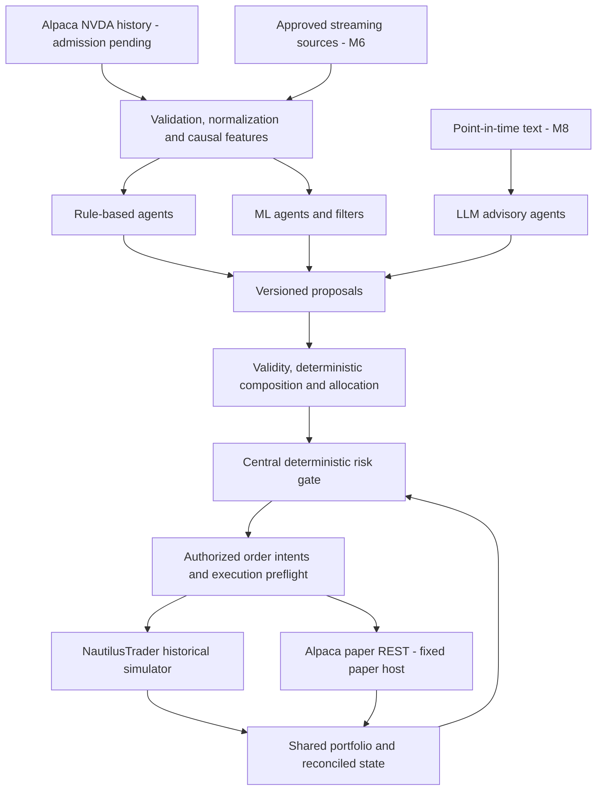

# Platform architecture

A local modular Python application: data, agents, coordination, portfolio, risk and execution behind small interfaces. [Requirements](../REQUIREMENTS.md) own acceptance criteria, [decisions](DECISIONS.md) own technology status, [glossary](../GLOSSARY.md) owns terminology. Scope: NVDA shares, Alpaca historical SIP, Alpaca as active paper execution broker (D-032); the retained MES path is synthetic, and the separate Alpaca path has a four-session raw SIP pilot with native storage and ITSM backtest integration ([evidence](data/ALPACA_PILOT.md)).

## Shape and boundaries

A local modular Python application is sufficient. Use library interfaces and one event loop/process first; no message broker, microservices or LLM orchestration framework is needed. The Alpaca paper REST adapter and bounded session runner share a stdlib SQLite intent/fill journal ([limits](PAPER_EXECUTION.md)). Account/current IEX reads are verified; actual paper fills remain unverified. The earlier IBKR native bridge remains inactive regression evidence. Create `src/drift/` modules only when an implementation milestone needs them.

These are logical responsibilities, not separate services. NautilusTrader supplies reusable market-event, simulation and execution facilities once compatibility is proven; it does not remove the need to test application portfolio/risk policy. No live adapter is enabled by this design.

| Boundary | Owns | Must not own |
|---|---|---|
| Data | Provider adapters, contract resolution, validation, immutable provenance, calendars, availability and feature snapshots | Strategy decisions or hidden forward fills |
| Research/backtest | Experiment configuration, folds, trials, cost/fill models, engine replay and metrics | Credentials or promotion based only on in-sample performance |
| Agents | Rule/model inference and structured proposals using allowed snapshots | Broker calls, final sizing authority or mutable risk limits |
| Coordination | Proposal validation, registered hybrid composition, deterministic conflict policy and allocations | Implicit confidence normalization or bypassing risk |
| Portfolio | Fill-based positions/cash/PnL, pending exposure, currency and agent attribution | Treating a submitted order as a fill |
| Risk | Configured limits, reservations for pending orders, eligibility, stale-data checks, halt and approval/rejection | Predictions, LLM interpretation or automatic limit changes |
| Execution | Approved-intent deduplication, account/mode validation, order lifecycle and reconciliation | Accepting raw proposals as orders |
| Analytics | Read-only Parquet/DuckDB research, comparisons and reporting | Sole durable order/position recovery state |

The [backtesting framework](BACKTESTING.md) composes these boundaries for simulation: `research/` depends on small seams (a market data source, an executor, a strategy registry) and owns orchestration, stored results and virtual portfolios. Strategies know nothing of it, and it has no path to a broker.

## Extension interfaces

Treat provider, instrument, strategy and execution as independent configuration axes. Small modules hide provider parsing, corporate actions, calendar/availability validation and broker lifecycle behind interfaces shared by their callers/tests. Use explicit dependencies rather than constructing vendor clients inside a strategy. Add an adapter or instrument configuration when an actual variation needs it; implement no plugin registry, distributed bus or universal market framework now.

| Extension | What may change locally | What stays shared |
| --- | --- | --- |
| Historical provider/feed | Fetch/parser adapter, query/rights metadata, timestamp semantics and fixture coverage | Validated observations, native catalog, causal snapshots and strategy consumers |
| Instrument | Effective identity/mappings, currency, increments, multiplier, sessions and product-specific actions/capabilities | Normalization invariants, configured strategy logic, portfolio/risk interfaces |
| Strategy | Registered policy (`backtest/registry.py`) and its parameters/state, detector/feature use and tests | Versioned proposals, final sizing/risk, execution lifecycle |
| Execution broker | Contract/order translation, connectivity and reconciliation adapter | Approved intents, account/risk preflight, fill/fee events and central ledger |

Data symbols are not broker contract IDs. Historical feed and live execution venue need explicit mapping and compatibility evidence; selecting Alpaca paper does not permit silently mixing historical SIP with operational IEX. Initial real configuration admits NVDA only; a second synthetic instrument/source proves extensibility without enabling another market. New product semantics require explicit capability/schema versioning and regression tests rather than weakening validation. [REQ-ARCH-002](../REQUIREMENTS.md) owns the measurable checks; [NVDA plan](data/NVDA_DATA_PLAN.md#modular-extension-contract) owns data details.

## Minimal integration contracts

Data exposes validated point-in-time observations keyed by instrument and availability time. Agent inputs contain a decision clock, data snapshot references and frozen rule/model configuration. Agents return the [proposal contract](#proposal-contract); they do not place orders.

Portfolio policy converts eligible directional proposals to candidate position changes under explicit sizing/allocation rules. Risk checks aggregate filled **and pending** exposure, reserves approved capacity, and produces an identified order intent bound to the account, mode, instrument, size, price/order constraints, expiry, proposal IDs and risk-policy version. Execution rechecks freshness, halt/account identity and reservation validity immediately before submission. Approval is invalid if material portfolio/market state changes; revalidate instead of treating approval as permanent.

Execution events carry intent/order IDs, broker acknowledgements, fills, cancel/reject events and fees into the single-writer portfolio ledger. Partial fills and cancel/fill races update reservations. Unknown submission outcomes halt new risk until reconciliation; retry does not imply a second order. Multi-agent research starts with synchronous ordered evaluation, not distributed consensus.

## Agents and the proposal contract

An agent is a domain component, not a synonym for LLM autonomy or a separate process; instrument, horizon and historical/paper mode are independent axes. Rule strategies are specified in [STRATEGIES.md](STRATEGIES.md).

### Three families

| Family | Inputs and decision mechanism | Candidate examples | Evaluation |
|---|---|---|---|
| Rule-based | Available market observations and fixed deterministic rules/statistics | M3a NVDA ITSM first; the other statistical rules (ORB, VWAP/Bollinger mean reversion, reversal, trend) are specified in [STRATEGIES.md](STRATEGIES.md); relative strength, stat-arb and volatility breakout are future | Replay identity, causal timing, net-cost OOS performance and robustness |
| ML | Causal features and a trained, versioned inference artifact | Logistic regression, random forest, LightGBM/XGBoost; independent predictions or meta-label filters | Fold/label integrity, calibration, drift and net comparison to simple controls |
| LLM | Licensed as-of news, earnings, filings, macro/events and evidence retrieval | Research assistant, event-risk assessment, sentiment/earnings interpretation | Evidence accuracy, temporal validity, injection tests, no-LLM baseline and full costs |

LSTM/Transformers and reinforcement learning are experimental options, not required infrastructure. Hybrids are compositions of these three families. An agent instance has an independent identity/configuration; instrument, horizon and historical/paper mode are separate axes.

### Proposal contract

Schema version 1, implemented in `src/drift/strategies/proposal.py` (its `family` admits RULE, ML or LLM; only RULE agents exist):

| Field | Meaning / validity rule |
|---|---|
| `schema_version`, `proposal_id` | Supported schema and globally unique/idempotent proposal identity |
| `agent_id`, `family`, `strategy_id` | Configured producer, one of RULE/ML/LLM, and policy/experiment lineage |
| `instrument_id` | Venue-qualified instrument with expiry/currency metadata; an advisory may reference a configured scope containing instruments |
| `generated_at_utc`, `data_asof_utc` | Creation time and latest availability of any input; both timezone-aware UTC |
| `valid_until_utc`, `horizon_seconds` | Expiry and intended decision horizon; expiry must follow creation |
| `intent` | LONG, SHORT, FLAT, NO_TRADE or ADVISORY; FLAT requests reducing a strategy allocation, not liquidating other agents' holdings |
| `rule_or_model_version`, `input_refs` | Versioned rule/model/feature/prompt references and reproducible source/artifact IDs |
| `rationale` | Short explanation plus evidence references; explanatory prose has no execution authority |
| `score`, `score_semantics` (optional) | Defined meaning and calibration version, never a universal comparable probability |
| `quantity_hint` (optional) | Non-binding suggestion; portfolio/risk determines approved size |
| `parent_proposal_ids` (hybrids) | Complete trace of upstream proposals and registered composition-policy version |

At processing clock `t`, require `data_asof_utc <= generated_at_utc <= t < valid_until_utc`, all referenced input availability times <= generation, and a known instrument/configuration/schema. Historical acquisition time is distinct from modeled historical availability. Reject unsupported schema, malformed/future data, bad lineage and already-consumed IDs. Record reason codes for rejections and abstentions. A duplicate cannot create an additional intent/order.

NO_TRADE is an explicit abstention, not an implicit cancellation. FLAT passes portfolio/risk checks and can only affect the appropriate attributed allocation. M3 evaluates one agent/instrument at a time: NVDA ITSM first, then independently configured statistical rules. More complex concurrent netting/attribution is introduced and tested in M7. Risk-reducing requests remain subject to order validity and broker reconciliation.

### Hybrid composition and conflicts

Future example: **Rule momentum proposal → ML accept/reject filter → LLM event-risk advisory → portfolio allocation → central risk → execution**. ML can also emit an independent directional proposal. LLMs emit ADVISORY only; any eventual use of advice is a registered, deterministic, tested composition policy. A positive model score cannot override a risk rejection.

For the initial hybrid policy, a missing/expired/invalid required filter leads to abstention. Optional filters are explicitly declared; omitted advice is never silently converted to approval. Opposite proposals for the same instrument follow a configured policy (initial conservative default: abstain on unresolved conflict), not arrival-order wins. Preserve gross contributions, pending orders and attribution even when net positions cancel. Do not add cross-agent score weighting until meaning/calibration is justified by an experiment.

### LLM trust and evaluation boundary

External text is untrusted data. Restrict retrieval tools to reviewed read-only sources; isolate credentials and portfolio policy. Schema-validate outputs, verify cited evidence exists, distinguish unknown from neutral, and reject instructions embedded in retrieved text. LLMs cannot invoke broker adapters, produce authorized order intents, change risk limits or run arbitrary tools/code.

Archive permissible source snapshots with publication/availability/revision times and record model/prompt/token costs and generated outputs. Deterministic replay uses captured outputs where allowed; repeat API calls are not assumed identical. Later-trained models can leak subsequent knowledge into historical evaluations; use suitable time-bounded evaluation/prospective testing and disclose remaining contamination. Tests cover injection, malformed JSON/schema, invented citations, later publication, stale data, unavailable model and cost-limit exhaustion. Completion measures evaluated research quality and failure behavior; useful trading benefit remains unproven.

## Time, instruments and storage

- Internal timestamps are timezone-aware UTC; US cash-window definitions use `America/New_York` and a versioned calendar. CME trading sessions are not identical to US cash sessions. Preserve event time, bar start/end, availability, acquisition time and vendor timezone semantics.
- Historical acquisition often occurs years after an event. Backtests use defensible simulated historical availability (bar completion plus declared delivery latency), while separately retaining actual acquisition time. Current downloads do not prove point-in-time revision history. Uncertain availability is recorded and sensitivity-tested, never silently asserted causal.
- Use a stable instrument identity with separate provider/broker mappings and effective price/quantity/currency/session metadata. For NVDA, preserve raw execution prices/shares and corporate actions; construct split-neutral signal returns explicitly. Expiry/roll validation belongs to future admitted futures and the retained MES fixtures, not to every equity. Continuous/adjusted research series cannot supply executable fills without a declared transformation back to raw units.
- M2 introduces ignored `data/raw/`, `data/curated/` and optional `data/catalog/drift.duckdb`; manifests/configuration without licensed data may be versioned. Parquet snapshots are immutable/versioned; corrections create new versions. Dataset rights govern archiving and redistribution.
- Model artifacts, scalers, prompts and inference outputs have version/hash provenance and data cutoffs. Keep large artifacts outside Git. Text must distinguish publication, ingestion and revision times; a current LLM may have memorized future information relative to a historical test, which must be disclosed and evaluated.

## Modes and reliability

Historical mode uses an explicit simulated clock and execution model. Paper mode consumes approved real-time feeds and a strictly allow-listed paper account. Share proposal/portfolio/risk semantics while testing actual differences in timestamps, fill behavior and broker support; parity is a goal, not assumed equivalence.

Before M6, choose a minimal durable journal/recovery mechanism based on verified framework capabilities. Recovery loads durable intents/events, queries broker state and reconciles positions, open orders and fills before resuming. Logs are sanitized and correlated by run/agent/proposal/intent IDs. Missing state, feed loss, stale advisories, clock anomalies or unknown orders fail closed for new risk. A kill switch blocks new exposure and follows an explicit cancellation/liquidation policy; it cannot promise immediate fills during an outage.

## Staged construction

Milestones, gates and exclusions live in [ROADMAP.md](ROADMAP.md). A coherent released Python/NautilusTrader/API/docs tuple is proven offline first; `latest` documentation is not version evidence.
