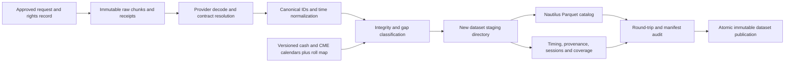

# M2b ingestion architecture and acceptance gates

Design only, 2026-10-29. No ingestion code, data files, credentials or infrastructure are created by M2a. [HISTORICAL_DATA_SPEC.md](HISTORICAL_DATA_SPEC.md) owns dataset/session/time/roll policy; [PROVIDER_COMPARISON.md](PROVIDER_COMPARISON.md) owns procurement evidence. Implements REQ-DATA-001–004, relevant REQ-RESEARCH-001/SEC-002 and the data stage of the existing [architecture](../ARCHITECTURE.md).

**Subsequent evidence:** the [M2b.1 implementation report](M2B1_IMPLEMENTATION.md) maps these gates to native synthetic DBN/catalog/replay tests and documents working commands, strict partition rejection and resource limits. The [M2b.2 preparation plan](M2B2_ACQUISITION_PLAN.md) records public research, exact proposed jobs, real-admission prerequisites and the detailed 013/014 procedure. The design below remains the broader M2b target. Acquisition/admission is disabled; gates 013/014 and real-provider/calendar/rights evidence remain pending.

## 1. Scope and stages

Build one local, bounded-memory pipeline, using the existing `quantlab` package and pinned NautilusTrader **1.231.0**. Default implementation target is the conditionally recommended **Databento DBN** source. Implement an alternative FirstRate CSV reader only if procurement selects it; document the same normalization boundary rather than building all providers or a plugin framework. IBKR has no acquisition role for the specified old archive and no broker wrapper is needed in M2b.

1. **Offline foundation first:** versioned request/config schema, fixture/local-file reader, metadata resolution, normalization, integrity checks, catalog persistence and deterministic reports. These steps can be tested with labeled synthetic fixtures without account access or spend.
2. **Separately gated acquisition:** accept approved local vendor artifacts, or add an explicit bounded historical-only download operation after quote/rights/budget approval. Data downloads are never automatic on package import, CLI help, test startup or backtest run. No streaming/execution clients or live account settings.
3. **Pilot admission, then archive:** validate the two frozen 2022 pilot slices before scaling to the six-year contract chain. Report an unresolved procurement/data gate honestly if files or approvals are absent; passing fixture tests alone does not complete real-data ingestion.

M2c remains responsible for higher-level causal feature/label views and broader analytical research. M2b nevertheless must validate the session/roll/timestamp and gap primitives needed to store usable data safely. Do not postpone fundamental integrity checks to M3. No ITSM proposal, return strategy, model, order or backtest tuning is implemented here.

## 2. Minimal responsibilities and flow



Keep small modules/functions under `src/quantlab/data/` when M2b is authorized. One source-reader boundary accepts an approved file/request, source contract metadata and chunk bounds, and yields bounded homogeneous instrument/bar batches plus provenance. A normalizer returns native framework instruments/bars and sidecar records. Validators return accepted/quarantined records and machine-readable reasons. These are responsibilities, not a requirement for abstract base classes, services or speculative agent interfaces.

Future stock/crypto/FX readers can meet the same observation/provenance boundary with asset-specific identity, calendar, currency and adjustment rules. Do not fill a stock's expiry with a fake futures value or assume crypto has NYSE sessions. Only MES minute trades are supported by the initial implementation; reject unsupported assets/schema/intervals explicitly. No database server, scheduler, event bus or cloud storage.

## 3. Request/config and acquisition boundary

A versioned configuration must specify `dataset_spec_id`, provider/dataset, explicit contracts/periods, schemas, local raw destination, interval, calendar/roll versions, ID mapping version, source aggregation clock, availability policy/delay, revision policy, cost ceiling/currency, quote timestamp/parameters, rights-record reference and permitted operations. No embedded API key/account ID. Select `offline` versus explicitly authorized historical acquisition; no paper/live mode or implicit network fallback. The exact source schema for the primary path is `GLBX.MDP3` / `ohlcv-1m` plus definitions and ID mappings.

Before download, match approved quote parameters to request parameters, including schema/IDs, half-open bounds, metadata requests, repeat downloads and applicable licensing. Fail closed on missing/expired approval, unknown cost, exceeded ceiling or wider request bounds. Authentication, if later approved, comes from a secret outside Git and is never serialized into configs/logs/manifests. Do not include credentials or signed download URLs in errors. Merely selecting a provider does not authorize a billable metadata/data call.

Chunk by actual contract and calendar month, clipped to its [active/warm-up/roll-overlap windows](HISTORICAL_DATA_SPEC.md#5-contracts-and-fixed-roll-policy). Each request has a stable normalized request ID. Persist native **data payload** bytes and an allow-listed, sanitized request/coverage receipt with SHA-256, retrieval time, record count, outcome and non-sensitive content-type/length/provider revision/checksum/request ID. Never persist authorization/cookie headers, signed URLs, redirect locations or sensitive query values. A receipt records successful empty responses distinctly from failed requests. Bounded retry/backoff and checkpointed resume reuse verified chunks; a retry is not a new uncapped purchase. Refuse automatic overwrite of a chunk whose contents changed. Sanitized authentication failures must not trigger an unauthenticated substitute source.

## 4. Decode and temporal normalization

Reuse the release's [DatabentoDataLoader](https://github.com/nautechsystems/nautilus_trader/blob/v1.231.0/nautilus_trader/adapters/databento/loaders.py) for DBN definitions/bars. Inspect exact installed signatures in M2b; M2a read the installed source and queried the tagged APIs, without loading market files. Load definitions/precision before bars. Use `as_legacy_cython=True` for the existing legacy BacktestEngine path; do not pass incompatible PyO3 objects directly to it. Explicitly disable silent decode skipping (`skip_on_error=False`).

Decoder `bars_timestamp_on_close=True` handles the start→completion shift. Verify a known one-minute fixture; after decode the project sets `ts_event=bar_end`, `ts_init=available_at` according to the frozen policy (baseline end+1s). Preserve original start/bucket clock separately. Never add another minute to a bar already shifted by the decoder. Changing availability policy creates a new derived dataset version/view; raw bytes remain unchanged.

`use_exchange_as_venue` changes native IDs; neither default `GLBX` nor exchange `XCME` is silently assumed identical to project alias `CME`. Resolve provider/dataset/publisher/instrument ID/raw symbol with effective dates into canonical `CME:MES:YYYYMM` and framework `MES-YYYYMM.CME`. Validate actual MES product, USD/tick/multiplier, expiry and source venue first. Per-file ID overrides are allowed only when the file is proved single-contract; never stamp one ID onto mixed-contract records. Retain source aliases and definition revisions for reverse tracing.

For a selected FirstRate CSV fallback, localize documented Eastern start timestamps with explicit DST ambiguity handling, shift start→end once, preserve volume and construct native bars. The installed **legacy** `BarDataWrangler.process` supports a timestamp index and `ts_init_delta`, but can fabricate default volume if omitted: validate required OHLCV before calling it, or construct native bars directly from exact scaled values. Do not copy unrelated V2 wrangler examples. Ambiguous naive Eastern records without offset/sequence evidence are quarantined, not guessed.

Clock mapping, integer/fixed-point price conversion and duplicate/revision behavior are source adapters' obligations. Every native Bar admitted to the replay catalog has `ts_event <= ts_init`, expected one-minute interval and a sidecar identity. Sorting by `ts_init` does not itself prove causal construction; endpoint/availability tests do.

## 5. Storage and schema ownership

Use immutable raw files and **one curated price source of truth**: Nautilus `ParquetDataCatalog` for native futures instruments and Bars. Its layout/Arrow schema are framework-owned, not reimplemented. Additional Parquet/JSON sidecars carry fields native Bars do not represent. No second bespoke OHLCV warehouse. Paths are illustrative future outputs, all ignored under `data/`:

```text
data/raw/<provider>/<dataset>/<request_id>/<chunk_id>.<native-format>
data/raw/<provider>/<dataset>/<request_id>/receipts.json
data/curated/mes_itsm_v1/<dataset_version>/
  catalog/                 # Framework-managed native Parquet
  provenance.parquet       # Row identity, source, raw offset, start/end/availability
  contracts.parquet        # Effective metadata/ID mapping and definition references
  sessions.parquet         # Cash/CME calendar, roll and strategy exclusion map
  coverage.parquet         # Expected/retrieved/gap classifications
  quality.json
  manifest.json
data/catalog/quantlab.duckdb  # Optional rebuildable analytical views
```

| Sidecar/manifest group | Required fields and invariants |
|---|---|
| Row key | `dataset_version`, canonical contract, native `bar_type`, interval and `bar_start_utc_ns`; exactly one admitted native row per key |
| Provenance | provider/dataset/publisher/raw instrument ID/raw symbol, raw file hash and record offset/key, definition reference, source schema/aggregation clock/raw label, normalization version |
| Time | start/end/availability UTC nanoseconds, availability kind (`modeled`/`measured`), delay-policy version and retrieval time; raw receive time nullable if genuinely absent, never fabricated |
| Contract | expiry month, actual expiration/last trade, activation nullable with reason, currency/tick/multiplier/lot, exchange/MIC/project alias and effective mapping range |
| Session | cash date, exchange trade date, UTC date, cash open/close, calendar/version, selected K, roll effective time, separate as-of input status and later outcome/quality status/reasons; keep expected dates even when no rows arrive |
| Manifest | spec/config/code commit/lock/framework versions, all raw/curated hashes and counts, chunk coverage/status, calendars/rights record references, quality failures/exclusions, timestamp/revision policies and source limitations |

Use exact integer/fixed-point/native decimal semantics; JSON reports can use decimal strings. Native catalog fields may be binary fixed-point representations, so DuckDB views must decode through a documented tested Arrow/decimal projection rather than treating bytes as floating prices. DuckDB is optional and fully rebuildable from the published catalog/sidecars; it is not the only copy of provenance or an execution ledger. Typed joins must preserve timestamp units/timezone and never merge expiries by root ticker.

`ParquetDataCatalog.write_data` warns that an existing filename can be overwritten. Therefore write only to a new version-specific staging root, enforce disjoint chunk keys, validate round-trip counts/prices/timestamps/metadata, hash the complete manifest and atomically rename into an unused final directory. A second identical run returns the same logical dataset identity and reuses verified output; it must not append duplicate volume. Revisions create a new version. An interrupted staging tree is visibly incomplete and cannot be discovered as a published dataset. [Pinned catalog implementation](https://github.com/nautechsystems/nautilus_trader/blob/v1.231.0/nautilus_trader/persistence/catalog/parquet.py).

Dataset identity is a hash of normalized config, ordered raw content hashes, transformation/framework versions and calendar/roll/rights versions. Keep mutable run receipt/wall-clock diagnostics separate from this logical identity. If byte-identical Parquet is not guaranteed across software versions, record exact emitted hashes and compare logical row content under pinned versions; do not claim cross-version binary determinism.

## 6. Validation, endpoints and exclusions

Implement [the dataset's quality table](HISTORICAL_DATA_SPEC.md#6-required-fields-and-quality-rules) as deterministic rules before publication. Preserve raw inputs and rejected rows/reasons; no forward fill, fabricated OHLCV, nearest-neighbor endpoint or silent provider blending. Exact duplicates may coalesce with counts; conflicting values remain quarantined until an explicit revision policy resolves them in a new version. Retain unresolved in-session gaps and their denominator; distinguish causal input unavailability from post-decision missing outcomes, which cannot retroactively veto a decision.

Build an auditable **endpoint-reference table** (keys/timestamps, no strategy decisions or trade proposals) for previous close, 10:00, 15:00, 15:30 and 16:00. Endpoint admission requires the exact populated bucket of the selected same contract, an eligible full cash session and the known availability policy. Missing/roll/early-close/post-early-close cases carry reason codes. The 16:00 reference can support later labels but is not included in an as-of 15:30 decision snapshot. A missing later target leaves the earlier input snapshot unchanged; M3 must preserve any original proposal/attempt and unresolved outcome instead of rewriting history as NO_TRADE. Causal research feature calculation and trading logic remain M2c/M3.

Separate data validity from financial suitability: calendar/coverage/type tests can pass even when there is no profitable strategy. Raw trade bars do not establish bid/ask fills, market impact, intraminute stop/target ordering or original revision-time availability. Do not certify an archive as point-in-time merely because its rows have timestamps.

## 7. M2b acceptance matrix

All code gates run offline with small clearly synthetic fixtures. Vendor-data gates require approved artifacts; absent quote, license or real files is an explicit unmet gate, never a silent skip described as full success.

| ID | Gate and concrete evidence |
|---|---|
| M2B-001 | Valid/invalid config tests reject unknown provider/schema/asset, empty/widened windows, malformed metadata, missing rights or cost authorization for any acquisition, and secrets in persisted config. Offline file mode never opens a socket. |
| M2B-002 | Native reader tests decode definitions and minute bars with exact identity/price precision; wrong product/tick/expiry, mixed-contract override and malformed DBN/CSV fail with bounded diagnostics. |
| M2B-003 | Known start-labeled bar becomes end-labeled exactly once; native `ts_init` equals modeled availability, not the original start. Rejected negative/naive/ambiguous/impossible times include both DST transitions and prior-session offset changes. |
| M2B-004 | Exact endpoint fixtures prove buckets 09:59/14:59/15:29/15:59, no future/stale substitute, and 16:00 data unavailable to 15:30. Removing the later target does not change the earlier as-of input status. Preserve real publication versus modeled availability distinction. |
| M2B-005 | Calendar fixtures cover overnight/weekend/holiday, Thanksgiving closure, November 25, 2022 early close, following-session exclusion, DST and actual expiry exceptions. Cash eligibility and CME trade date remain separate. |
| M2B-006 | Fixed Monday roll map and outgoing/incoming metadata tests skip the first switched cash session; no return or endpoint links two expiries, no current-day-volume lookahead, December-to-March mapping crosses years correctly. |
| M2B-007 | Missing volume/invalid OHLC/negative or off-tick price/fractional volume/unknown ID are rejected. Native wrangler cannot supply invented default volume. Numeric round-trip preserves MES tick/volume exactly. |
| M2B-008 | Duplicates across overlapping chunks are idempotent; conflicting revisions are retained/rejected according to declared policy; no silent overwrites or combined providers for a session. |
| M2B-009 | Every requested chunk and expected cash session is classified; absent bars are not assumed zero trades. Missing input buckets block as-of input eligibility; later gaps produce unresolved outcome/quality status, never retroactive NO_TRADE. Both remain counted in coverage and decision/outcome denominators. |
| M2B-010 | Native Parquet write/read preserves row counts, identities, OHLCV, start/end/availability and contract definitions; sidecar join is one-to-one. Fresh-engine read-only replay observes exactly expected event times with no orders. |
| M2B-011 | Repeated identical input/config produces the same logical dataset identity and rows; modified raw byte/config/calendar yields a new identity. Crash before publication leaves no apparently complete output; published data cannot be overwritten. |
| M2B-012 | Logs/configs/manifests and committed fixtures contain no credentials/account identifiers or licensed market payloads; generated/raw/catalog/model files stay ignored. All existing M1 tests and format/lint/types continue to pass. |
| M2B-013 | Pilot real-data admission records an approved exact quote/rights record, verified three-contract metadata and both frozen 2022 pilot slices. Reports account for all requests/sessions, including intentional exclusions, gaps and errors. No financial results are required or produced by admission. |
| M2B-014 | Full-archive scale-up, if authorized in M2b scope, delivers all 25 required expiries/windows with the coverage thresholds in the dataset spec; report elapsed time/peak memory/bytes on pilot and agreed local budget before scaling. A pilot-only result must say archive pending. |

M2b is implemented and pilot-admitted only when M2B-001–013 pass; M2B-014 is an explicit scale-up gate, required before claiming the full archive/M2 dataset complete. M2c adds causal feature views and final research dataset admission. Neither a calendar-only plan nor an optimistic cost estimate counts as delivered coverage.

## 8. Open decisions and next implementation order

Before any real acquisition: resolve exact quote/retention permissions and actual contract definitions. Before archive admission: historical calendar provenance, exact source coverage/revisions and price/clock decoder fixture. Before economic conclusions: empirical sample adequacy and execution evidence remain M3/M5 gates.

M2b.1 has implemented the offline config/manifest, synthetic DBN/native-Bar round-trip, validation/staging/catalog/coverage and replay. The [M2b.2 preparation plan](M2B2_ACQUISITION_PLAN.md) now owns remaining quote/rights review, real-definition/calendar compatibility, bounded acquisition and pilot/archive acceptance sequencing. These remaining steps require the permissions stated there; the design itself grants no acquisition authorization.
